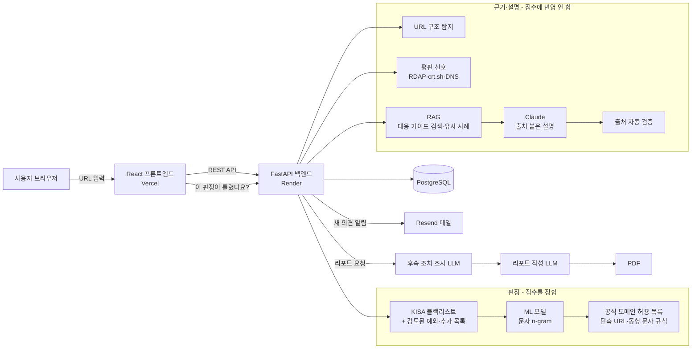

# URL 피싱 확률 분석

> 문자·메신저·메일로 받은 링크를 **눌러도 되는지**, 그리고 **지금 무엇을 해야 하는지** 알려 주는 AI 기반 피싱 URL 분석 서비스

- 배포 URL: 
- 백엔드 API: 
- 발표 자료: 

## 프로젝트 소개

스미싱 문자나 메신저로 받은 링크가 진짜인지 일반 사용자가 스스로 판단하기는 어렵습니다. 기존 서비스는 전문가용 판정 도구이거나(VirusTotal), 특정 앱 안에서만 쓸 수 있습니다.

이 서비스는 URL을 입력하면 **의심 사이트에 직접 접속하지 않고** 다음을 한 화면에 보여 줍니다.

- **3단계 판정**(안전 / 주의 / 위험)과 한 줄 이유, 지금 할 일 한 가지
- **"이미 눌렀다면?"** 상황별 즉시 조치와 공식 신고기관(118·112·1332) 연결
- **출처 번호가 붙은 AI 설명**: 공식 기관 가이드를 검색(RAG)해 근거로 쓰고, 출처 없는 문장은 코드로 걸러 냄
- 의심 특징마다 **왜 위험한지 + 어떤 피해로 이어지는지 + 학습 데이터 비교**
- AI가 후속 조치를 조사해 정리한 **분석 리포트(PDF)**

판정은 ML 모델과 공개 목록이 하고, 생성형 AI는 판정 근거를 설명하고 리포트를 작성하는 역할만 맡습니다. AI가 판정을 바꿀 수 없게 설계해 설명의 그럴듯함이 판정을 흔들지 않도록 했습니다.

## 팀원 및 역할

| 이름 | 역할 | 담당 업무 |
|------|------|-----------|
(오늘 중으로 수정 예정)

## 기술 스택

- **AI**: Anthropic Claude (출처 붙은 설명), OpenAI 호환 API (후속 조치 조사·리포트 작성), scikit-learn (URL 문자 n-gram 로지스틱 회귀)
- **RAG**: 공식 기관 대응 가이드 10건 TF-IDF 검색, URL 특징 기반 유사 사례 검색(최근접 5건)
- **Backend**: Python, FastAPI, PostgreSQL(운영) / SQLite(로컬), ReportLab(PDF)
- **Frontend**: React 19, Vite
- **Infra**: Render(백엔드·DB), Vercel(프론트엔드), GitHub
- **외부 공개 정보 조회**: RDAP(도메인 등록일), crt.sh(인증서 기록), Cloudflare DNS·Team Cymru(호스팅 정보)
- **알림**: Resend (판정 오류 의견 메일 알림)

## 시스템 아키텍처



## 핵심 AI 활용

### 1. RAG (검색 증강 생성)

- 탐지 근거에 맞는 **공식 기관 대응 가이드**(KISA·경찰청·금융감독원 등 10건)를 TF-IDF로 검색합니다.
- URL 특징 21개가 비슷한 **과거 피싱·정상 사례** 5건을 찾습니다.
- 근거([E1], [E2]…)와 가이드([G1]…)에 번호를 붙여 Claude에 넘기고, 모든 문장에 출처 번호를 달게 합니다.
- **자동 검증**: 출처 없는 문장, 없는 번호, 근거에 없는 숫자, 전화번호·URL이 들어간 설명은 버리고 템플릿 설명으로 대신합니다.

### 2. 다단계 AI 워크플로우

1. **후속 조치 조사**: 판정 근거를 보고 예상 피해 유형을 추론하고, 서버가 미리 정한 조치 목록 중 우선 조치를 고릅니다(목록에 없는 조치는 고를 수 없음).
2. **리포트 작성**: 판정 근거, 유사 사례, AI 설명, 조사 결과를 합쳐 쉬운 말로 정리합니다.
3. **검증·조립**: 전화번호·신고 주소·법률 정보는 LLM이 쓰지 않고 서버가 검증된 값을 넣어 PDF로 만듭니다.

### 3. 자동화 워크플로우

- **피드백 순환 구조**: "이 판정이 틀렸나요?" 의견 수집 → 관리자 메일 알림 → 사람 검토 → 블랙리스트 예외·추가 목록과 재학습 데이터 반영 → 재학습
- **개인정보 자동 정리**: 보관 기간(90일)이 지난 분석 기록을 매일 자동 삭제
- **LLM 비용 관리**: 정상 판정은 LLM 호출 생략, 같은 근거 조합은 24시간 설명 캐시

## 실행 방법

### 요구사항
- Python 3.11 이상
- Node.js 20 이상

### 설치 및 실행

```bash
git clone https://github.com/suahimnida/Phishing-Link-Checker.git   # TODO: 최종 저장소 주소 확인
cd Phishing-Link-Checker

# Backend (Backend 브랜치)
cd backend
pip install -r requirements.txt
cp .env.example .env        # 아래 환경변수 표를 보고 값 입력
uvicorn app.main:app --reload

# Frontend (Frontend 브랜치)
cd frontend
npm install
echo "VITE_API_BASE_URL=http://localhost:8000" > .env.local
npm run dev
```

### 환경변수

값은 저장소에 올리지 않고 Render·Vercel 대시보드에만 설정합니다.

| 위치 | 이름 | 용도 | 필수 |
|---|---|---|---|
| Render | `DATABASE_URL` | PostgreSQL 주소 (비우면 SQLite) | 운영 필수 |
| Render | `DB_PATH` | 로컬 SQLite 파일 경로 | |
| Render | `CORS_ORIGINS` | 프론트엔드 주소 허용 | 필수 |
| Render | `ANTHROPIC_AUTH_TOKEN`, `ANTHROPIC_BASE_URL`, `ANTHROPIC_MODEL` | 출처 붙은 AI 설명 | 없으면 템플릿 설명 |
| Render | `FOLLOWUP_OPENAI_AUTH_TOKEN`, `FOLLOWUP_OPENAI_BASE_URL`, `FOLLOWUP_OPENAI_MODEL` | 후속 조치 조사 | 없으면 기본 조치 |
| Render | `REPORT_OPENAI_AUTH_TOKEN`, `REPORT_OPENAI_BASE_URL`, `REPORT_OPENAI_MODEL` | 리포트 작성 | 없으면 템플릿 리포트 |
| Render | `RESEND_API_KEY`, `FEEDBACK_NOTIFY_TO` | 판정 오류 의견 메일 알림 | 없으면 메일 생략 |
| Render | `PYTHON_VERSION` | Render 파이썬 버전 | |
| Vercel | `VITE_API_BASE_URL` | 백엔드 API 주소 | 필수 |

선택 환경변수: `RETENTION_DAYS`(보관 기간, 기본 90), `REPUTATION_ENABLED`(평판 조회, 기본 켜짐), `RAG_TOP_K`(유사 사례 수, 기본 5), `FEEDBACK_MAIL_DAILY_LIMIT`(하루 메일 상한, 기본 50)

### 테스트

```bash
cd backend && python -m pytest -q      # 백엔드 테스트 320개
cd frontend && npm run lint && npm run build
```

## 모델 성능과 한계

평가 세트: 피싱 2,000건(KISA 2023), 정상 409건. 학습 데이터와 도메인이 겹치지 않게 구성했습니다.

| 구분 | 오탐률 (정상 → 피싱) | 미탐률 (피싱 → 놓침) | ROC-AUC |
|---|---|---|---|
| ML 단독 | 34.2% | 10.3% | 0.879 |
| 서비스 전체 (ML + 공식 도메인 허용 목록) | 2.0% | 10.3% | 0.978 |

서비스 전체 오탐률은 평가 세트 정상 URL의 81.2%가 허용 목록 도메인이라 낙관적인 값입니다. 처음 보는 정상 사이트는 ML 단독 수치를 기준으로 봐야 하며, 그래서 정확도로 경쟁하기보다 "왜 위험한지 설명 + 지금 할 일"에 집중했습니다. 자세한 분석은 [`docs/limitations.md`](docs/limitations.md)에 있습니다.

## 사용자 테스트 결과

- 전문가 멘토링 피드백 반영
- 베타 테스터: (오늘 중으로 보충 예정)
- 주요 피드백 및 반영 사항:
  - "결과에 수치와 기술 용어가 많아 일반 사용자가 이해하기 어렵다" → 결과 맨 위를 3단계 판정 + 한 줄 이유 + 지금 할 일로 바꾸고 상세 근거는 접는 카드로 이동
  - "이미 눌렀다면 무엇을 해야 하는지가 더 중요하다" → 상황별 즉시 조치와 118·112·1332 연결 추가
  - "판정이 틀렸을 때 알릴 방법이 없다" → "이 판정이 틀렸나요?" 의견 창구와 검토·재학습 순환 구조 추가

## AI 윤리와 개인정보

(오늘 중으로 보충 예정)
